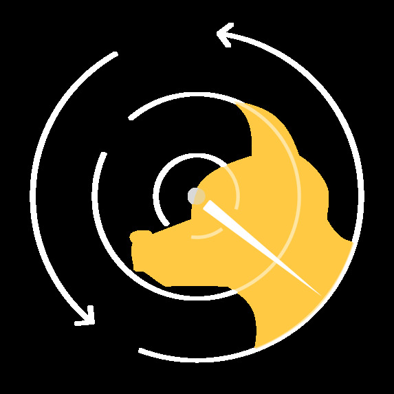
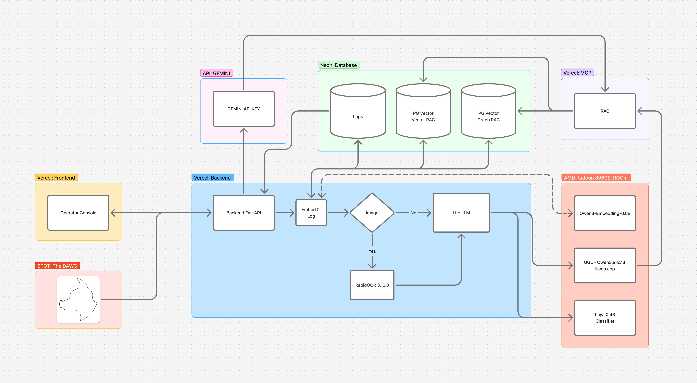
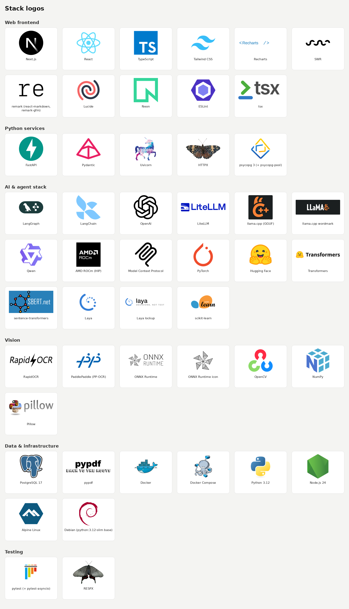

  

# SPOTLight

**An operator console that shows what Boston Dynamics SPOT found on an inspection, explains it in plain language, and backs every claim with evidence.**

[Live demo](https://spotlightdog.work/) (mirror: [spotlight-web-mu.vercel.app](https://spotlight-web-mu.vercel.app/)) · [Demo video](https://www.youtube.com/watch?v=jp-zHDLvZCQ) · [Devpost](https://devpost.com/software/spotlightdog?ref_content=my-projects-tab&ref_feature=my_projects)

This is a fork of our KnightHacks team project. It was built mainly for the NextEra Energy challenge and was also submitted to the Neon, Hugging Face, AMD, and MLH Best Use of Gemini tracks.

---

## Overview

SPOT reports a mission as COMPLETED even when steps inside it failed. In NextEra's dataset of 27 missions, 21 of the 26 "completed" missions contained a failed action, and 14 of the 15 serious anomalies happened inside them.

SPOTLight finds these hidden failures, explains them, and recommends what to do next. Every number and ID in an explanation is checked against the source data before an operator sees it.

## Features

- **Live patrol:** Watch SPOT move through a simulated route, with results shown at each stop.
- **Mission review:** Replay past missions and work through a priority queue of flagged issues.
- **Analytics:** See fleet-wide trends such as hidden failures, low-battery failures, and unreliable waypoints.
- **SPOTbot:** Ask questions in chat and get answers grounded in plant records.

Status is always shown with a color, an icon, and a label, so it never depends on color alone.

## How It Works

The system works in two stages.

**1. Triage.** A small classifier (Laya) and a set of rules decide which events need attention and how urgent they are. The rules set a minimum priority that the classifier can raise but never lower. Laya does not generate text, so it cannot make things up.

**2. Explanation.** For flagged events, a larger model (Qwen3.8-27B) writes a plain-language explanation with cited evidence and a recommended action. A checker confirms that every number and ID in the answer appears in the cited data. If an answer fails twice, the operator gets a clearly labelled template instead.

Drafts appear in about 3 seconds while the answer is being written. They are marked as unverified and replaced once the checked answer is ready.

**Retrieval.** Explanations and chat answers draw on 503 documents stored in Neon Postgres, including the SPOT manual, incident reports, policies, and operator notes.

**Images.** Gauge and thermal readings are computed by code rather than by an AI model. A gauge reading is only accepted when two independent methods agree. Otherwise, the operator is asked to retake the photo or read it manually.

## Tech Stack

- **Frontend:** Next.js on Vercel
- **Backend:** FastAPI and an MCP server on Vercel
- **Database:** Neon Postgres with pgvector
- **Models:** Laya (fine-tuned on an AMD Radeon 8060S), Qwen3.8-27B (served on an AMD Radeon Pro W7900D), Qwen3-Embedding-0.6B, and Gemini for SPOTbot
- **Tooling:** Docker, LangGraph, LiteLLM, and CI with 14 checks on every pull request

## Results

| Measure | Result |
|---|---|
| Laya accuracy (macro-F1) on unseen missions | 0.805 |
| Explanations accepted on the first try | 36 of 38 (94.7%) |
| Answers shown to operators that passed all checks | 38 of 38 |
| Typical / slow response time | 11.2 s / 15.0 s |

The fine-tuned Laya model is available on [Hugging Face](https://huggingface.co/Jyler/KnightHacks-Laya-Model).

## What We Learned

- Exploring the data first gave us our main idea.
- Rules and classifiers are better at deciding what matters. Language models are better at explaining it.
- A health check that says "OK" does not prove the model is working. Test with a real request.
- Streaming drafts made slow answers feel fast without changing the model.
